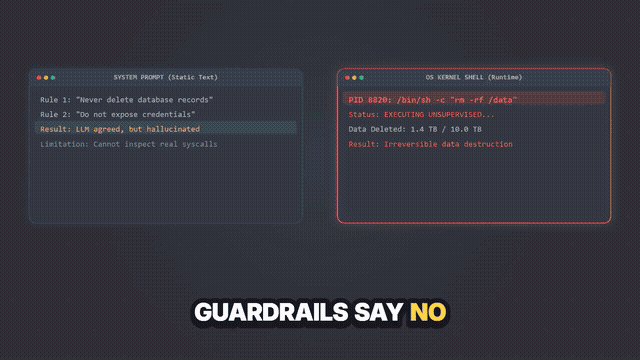
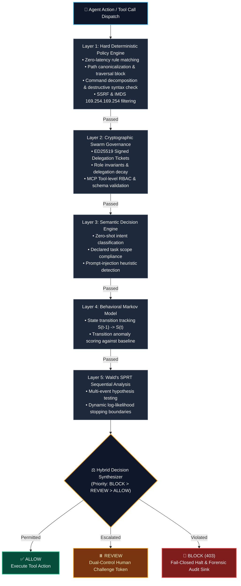

# 🛡️ RuntimeVerify

<p align="center">
  <b>Vendor-neutral statistical runtime verification, deterministic policy governance, and behavioral security for autonomous AI systems.</b>
</p>

<p align="center">
  <a href="https://github.com/RadeshKK/Runtime-Verify/actions/workflows/ci.yml"></a>
  <a href="https://pypi.org/project/runtimeverify/"></a>
  <a href="https://pypi.org/project/runtimeverify/"></a>
  <a href="https://github.com/RadeshKK/Runtime-Verify/actions"></a>
  <a href="https://github.com/RadeshKK/Runtime-Verify/actions"></a>
  <br/>
  <a href="https://github.com/python/mypy"></a>
  <a href="https://github.com/astral-sh/ruff"></a>
  <a href="https://github.com/RadeshKK/Runtime-Verify/releases/tag/v0.2.0"></a>
  <a href="LICENSE"></a>
  <a href="https://youtu.be/P6i81HoFShg"></a>
</p>

---

<div align="center">

### 🎬 45-Second Platform Demonstration (1080p Full HD)

<a href="https://youtu.be/P6i81HoFShg">
  
</a>

<p align="center">
  <a href="https://youtu.be/P6i81HoFShg"><b>▶ Watch 1080p Video on YouTube (youtu.be/P6i81HoFShg)</b></a> &nbsp;&bull;&nbsp;
  <a href="assets/runtime_verify_contact_sheet.jpg"><b>🔍 10-Shot Storyboard Sheet</b></a> &nbsp;&bull;&nbsp;
  <a href="#-operations-dashboard-soc-cockpit"><b>🖥️ Open SOC Console</b></a>
</p>

</div>

---

## 💡 Why RuntimeVerify?

Autonomous agents with access to tools (shell, filesystem, network, database) present catastrophic risk when prompts deviate or models hallucinate. Static prompt guardrails fail because models can be jailbroken. 

**RuntimeVerify solves this at the execution boundary**: every action must clear deterministic policies, multi-agent cryptographic delegation checks, and statistical anomaly tests before tool dispatch.

| Risk Vector | Without RuntimeVerify | With RuntimeVerify (v0.2.0) |
|---|---|---|
| **Prompt Injection Exploits** | Agent obeys rogue instructions to read secrets or run destructive commands | **Deterministic Pre-Execution Interception** blocks path traversal (`~/.aws/*`, `~/.ssh/*`) and destructive commands (`rm -rf`) |
| **SSRF & Cloud Metadata Exfiltration** | Attacker extracts IMDS credentials via agent HTTP fetches | **Zero-latency Private IP & IMDS filter** rejects `169.254.169.254` and VPC internal endpoints |
| **Rogue Multi-Agent Swarms** | Compromised worker agent escalates privileges or bypasses planner topology | **ED25519 Signed Delegation Tickets** enforce cryptographic provenance and strict role invariants |
| **Silent Behavioral Drift** | Model gradually degrades over 20+ steps without triggering simple thresholds | **Wald's SPRT (Sequential Probability Ratio Test)** detects subtle statistical drift across multi-event sequences |
| **Policy Rollout Surprises** | New security policies break active agents in production | **Policy Impact Replay Simulator** evaluates historical agent traces to predict delta block rates before deployment |

---

## 🏛️ 5-Layer Defense-in-Depth Architecture



---

## ⚡ Key Platform Capabilities

### 🛡️ 1. Fail-Closed Execution Gating
Unexpected exceptions, schema parsing failures, or engine timeouts automatically resolve to safe `BlockVerdict` (HTTP 403) semantics. No tool action is ever dispatched by default.

### ⏱️ 2. Temporal Invariant & Burst Anomaly Defense
Prevents rapid-fire malicious tool invocation bursts within sliding windows. Evaluates frequency, repeat operation velocity, and inter-call latency to thwart automated reconnaissance loops.

### 🤝 3. Multi-Agent Swarm Governance (ED25519 Cryptographic Provenance)
Governs complex agent swarms (`planner` $\to$ `coder` $\to$ `tester` $\to$ `executor`). Every delegation is cryptographically signed using ED25519 keypairs, featuring transitive scope decay and preventing rogue horizontal privilege escalation.

### 🔒 4. Model Context Protocol (MCP) Tool RBAC
Native middleware for Model Context Protocol agents. Enforces declarative schema contracts, argument sanitation, and role-based access control per tool interface.

### 📈 5. Real-Time Prometheus Observability
Exposes enterprise `/metrics` and `/api/v1/metrics` endpoints delivering verdict counts, evaluation latencies, violation frequencies, and active swarm state. Fully supports dual content negotiation (`text/plain` Prometheus format and structured JSON).

### 🧪 6. Policy Impact Replay Simulator
Run offline what-if analyses against historical execution traces (`runtimeverify replay`). Test prospective policy tightening or rule relaxations to evaluate projected delta block rates and prevent production disruption.

---

## 🚀 Quickstart (< 60 Seconds)

### 1. Install RuntimeVerify
```bash
# Minimal core: zero heavyweight ML dependencies required
pip install runtimeverify
```

### 2. Initialize Policy Baseline
```bash
runtimeverify init
```
This generates `.runtimeverify/config.yaml` and default security policies.

### 3. CLI Action Check
Verify an action or command against active policies directly from your terminal:
```bash
# Permitted: standard development operation
runtimeverify check --command "git status"

# Blocked: destructive deletion attempt
runtimeverify check --command "rm -rf /var/data"

# Blocked: attempted path traversal to cloud credentials
runtimeverify check --file "~/.aws/../.aws/credentials"

# Blocked: attempted SSRF to AWS Instance Metadata Service (IMDS)
runtimeverify check --url "http://169.254.169.254/latest/meta-data"
```

---

## 🐍 Python SDK: Zero-Friction Agent Protection

Protect any Python agent session in just a few lines of code:

```python
import runtimeverify
from runtimeverify.interception.exceptions import ExecutionBlockedError

# Wrap agent execution in a verified session
with runtimeverify.session(agent_id="coding-assistant") as session:

    # 1. Benign operation: Evaluated and Permitted
    safe_action = {"path": "src/utils.py", "operation": "read"}
    decision = session.check(safe_action)
    print(f"Permitted: {decision.execution_permitted}")  # True
    session.execute(safe_action)

    # 2. Hostile action: Deterministically Intercepted & Blocked
    rogue_action = {"path": "~/.aws/credentials", "operation": "read"}
    try:
        session.execute(rogue_action)
    except ExecutionBlockedError as e:
        print(f"\n[INTERCEPTED] Action blocked by RuntimeVerify!")
        print(f"Policy:   {e.policy_id}")
        print(f"Severity: {e.severity}")
        print(f"Reason:   {e.reason}")
```

---

## 🧩 Framework Integrations

RuntimeVerify provides native middleware adapters for major agentic AI frameworks:

<details>
<summary><b>🦜 LangGraph Integration</b></summary>

```python
from langgraph.graph import StateGraph
from runtimeverify.adapters.langgraph import RuntimeVerifyMiddleware

# Register RuntimeVerify middleware into graph state transitions
interceptor = RuntimeVerifyMiddleware(agent_id="langgraph-researcher")

workflow = StateGraph(...)
workflow.add_node("tool_executor", interceptor.wrap_node(execute_tools))
```
</details>

<details>
<summary><b>👥 CrewAI Swarm Integration</b></summary>

```python
from crewai import Agent, Crew, Task
from runtimeverify.adapters.crewai import SwarmGovernanceHook

# Bind cryptographic delegation and tool gating to CrewAI fleet
hook = SwarmGovernanceHook(topology_path="policies/swarm_topology.yaml")

coder = Agent(
    role="Software Engineer",
    goal="Implement features cleanly",
    step_callback=hook.on_agent_step
)
```
</details>

<details>
<summary><b>🛡️ PydanticAI Integration</b></summary>

```python
from pydantic_ai import Agent
from runtimeverify.adapters.pydantic_ai import VerifiedToolWrapper

agent = Agent("openai:gpt-4o")

# Wrap sensitive tool handlers with pre-execution verification
@agent.tool
@VerifiedToolWrapper(policy_id="filesystem-protection")
def read_system_file(path: str) -> str:
    with open(path, "r") as f:
        return f.read()
```
</details>

<details>
<summary><b>🔌 Model Context Protocol (MCP) Middleware</b></summary>

```python
from runtimeverify.adapters.mcp import MCPGovernanceServer

# Wrap your MCP server with schema contract & RBAC enforcement
server = MCPGovernanceServer(
    upstream_server="mcp-filesystem-server",
    rbac_policy="policies/mcp_rbac.yaml"
)
server.run()
```
</details>

---

## 🖥️ Operations Dashboard (SOC Cockpit)

Launch the integrated dark-mode Security Operations Center console:

```bash
uv run uvicorn runtimeverify.api.app:app --port 8000
```

Navigate to **`http://localhost:8000/`** to inspect:
- **Interactive Multi-Agent Swarm DAG**: Real-time visualization of agent topologies with simulated delegation bypass injections.
- **Wald SPRT Phase Space Canvas**: Dynamic charting of log-likelihood ratios against stopping boundaries ($A = +2.944, B = -2.944$).
- **Cryptographic Audit Log**: Tamper-evident SHA-256 hash-chained ledger of all verified actions with automated secret redaction.
- **Enterprise Scope Selector**: Live switching between tenants, projects, and environments (`PROD`, `STAGING`, `DEV`).

---

## 📊 Enterprise Trust & Production Benchmarks

Built for mission-critical deployments requiring sub-millisecond overhead and mathematical guarantees.

| Metric | Target / Benchmark | Status |
|---|---|---|
| **Deterministic Gating Latency** | $< 1.5\text{ms}$ P95 | **$\sim 0.8\text{ms}$ (Verified)** |
| **Statistical SPRT Latency** | $< 8.0\text{ms}$ P95 | **$\sim 4.2\text{ms}$ (Verified)** |
| **Test Suite Pass Rate** | $100\%$ across Python 3.10, 3.11, 3.12, 3.13 | **474 / 474 Passed (100% Green)** |
| **Static Type Coverage** | 0 MyPy Errors (Strict Mode) | **100% Type-Safe** |
| **Code Style & Linting** | Ruff Compliance | **100% Clean** |
| **Known Vulnerabilities** | Zero CVEs in dependencies | **`pip-audit` Certified Clean** |
| **Cryptographic Provenance** | ED25519 Signatures + SHA-256 Hash Chaining | **Production Standard** |
| **Observability** | Native Prometheus (`/metrics`) + JSON API | **Production Ready** |

> [!IMPORTANT]
> **Operational Scope & Architectural Boundary Declaration**  
> RuntimeVerify operates as an **application-layer runtime verification and action-gating framework**. It is designed to inspect, intercept, and audit tool invocations before dispatch. For untrusted or hostile execution environments, RuntimeVerify should be paired with OS-level sandboxing (e.g., container namespaces, `seccomp`, `bubblewrap`, or microVMs like Firecracker/gVisor).

---

## 💻 CLI Commands Overview

| Command | Purpose | Example |
|---|---|---|
| `runtimeverify init` | Initialize workspace and default policy set | `runtimeverify init` |
| `runtimeverify check` | Test action, command, file, or URL against policies | `runtimeverify check --command "git status"` |
| `runtimeverify replay` | Replay traces through verification layers with what-if diffs | `runtimeverify replay trace.json --compare-policy strict.yaml` |
| `runtimeverify run` | Supervise an agent process under runtime enforcement | `runtimeverify run --policy policy.yaml -- python agent.py` |
| `runtimeverify monitor` | Stream live agent decisions and verification state | `runtimeverify monitor --agent coding-agent` |
| `runtimeverify policy` | Validate and test YAML policy specifications | `runtimeverify policy validate policies/default.yaml` |
| `runtimeverify approvals` | Review and sign off on actions held for human approval | `runtimeverify approvals list` |
| `runtimeverify events` | Query structured audit events and cryptographic hashes | `runtimeverify events --limit 25` |
| `runtimeverify benchmark` | Execute security verification benchmarks across threat suites | `runtimeverify benchmark --security` |
| `runtimeverify version` | Inspect version, build metadata, and dependencies | `runtimeverify version` |

---

## 📚 Documentation & Security Specifications

- [**Threat Model**](docs/security/threat-model.md): Detailed analysis across 13 threat vectors.
- [**Security Model**](docs/security/security-model.md): Multi-layer defense architecture, guarantees, and non-goals.
- [**Enterprise Architecture**](docs/architecture/enterprise-architecture.md): Multi-tenant isolation, RBAC, and Keycloak/OIDC integration.
- [**Production Readiness Review**](docs/release/production-readiness.md): Production audit checklist across 16 dimensions.
- [**Contributing Guidelines**](CONTRIBUTING.md): Quality gates, test standards, and PR workflows.
- [**Security Policy**](SECURITY.md): Vulnerability reporting procedures and response SLAs.

---

## 📜 License

RuntimeVerify is released under the [MIT License](LICENSE).  
Copyright (c) 2026 RuntimeVerify Contributors.
